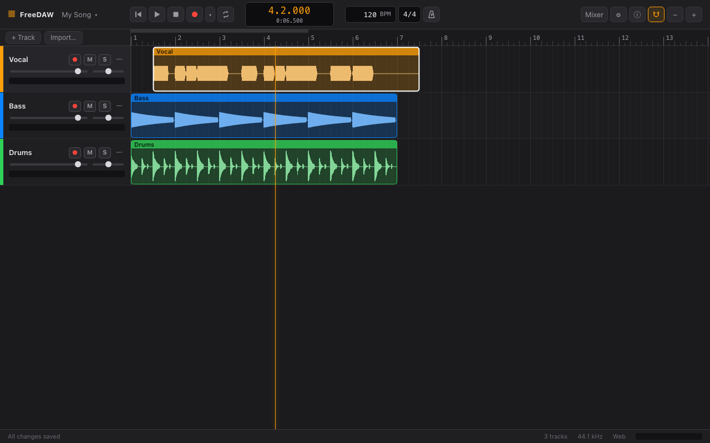

# FreeDAW user manual

FreeDAW is a free digital audio workstation for recording, editing and mixing audio. Its standout
feature is **Tune**: graphical, note-by-note pitch and timing editing for vocals and other
single-voice instruments.

## Contents

1. [Getting started](getting-started.md): web or desktop, your first project in five minutes
2. [The interface](interface.md): a tour of the main window
3. [Projects](projects.md): saving, opening, backing up and sharing
4. [Importing and editing audio](editing.md): clips, trimming, fades, splitting
5. [Recording](recording.md): inputs, arming, count-in, punch and latency calibration
6. [Tune](tune.md): correcting pitch and timing note by note
7. [Mixer](mixer.md): levels, panning, buses, sends and effects
8. [Effects reference](effects.md): every built-in effect and its controls
9. [Automation](automation.md): changing levels and effect settings over time
10. [Settings](settings.md): language and audio devices
11. [Keyboard shortcuts](shortcuts.md)
12. [Troubleshooting](troubleshooting.md)
13. [Glossary](glossary.md)

## Conventions

- **⌘/Ctrl** means the ⌘ Command key on a Mac and the Ctrl key on Windows and Linux. **Alt** is
  the ⌥ Option key on a Mac.
- Button names are written in **bold**, as they appear in the app.
- Positions are written as bars and beats: `3.2` is bar 3, beat 2.

Found a mistake or something missing? [Open an issue](https://github.com/campos20/freedaw/issues).
