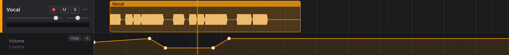

# Automation

Automation changes a setting over time: lower the vocal during the intro, raise a send for a
reverb throw, sweep a filter.

## Showing a lane

- Open a track's ⋯ menu and choose what to automate under **Automation**: **Volume**, **Pan**,
  each **Send**, or an effect setting.
- Or click **A** next to a setting in an [effect's editor](mixer.md#effects).

The lane opens under the track and starts flat at the setting's current value.

## Editing points

| To             | Do                                |
| -------------- | --------------------------------- |
| Add a point    | Click on the lane.                |
| Move a point   | Drag it.                          |
| Delete a point | Double-click it, or Alt-click it. |

Between points, the value changes in a straight line. Before the first point and after the last,
it stays at that point's value. Points snap to the grid like clips (hold ⌘/Ctrl to place freely).
Every change can be undone.

During playback, a setting with automation points follows its lane. To change it, edit the
points.

## Hiding and deleting

- **Hide** closes the lane but keeps its points, so the automation keeps working. Show it again
  from the ⋯ menu.
- **✕** deletes the lane and its points.

The lane's header shows its name and how many points it has.
