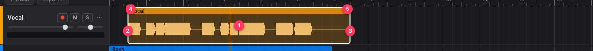

# Importing and editing audio

## Importing

- **Drag and drop** audio files onto the timeline. Drop onto a track to place the file there, at
  the point where you drop it; drop below the tracks to create a new track for each file.
- Or click **Import…** at the top left: each file goes on a new track, at the start of the
  project.

Supported formats: WAV, FLAC, MP3, OGG Vorbis and M4A/AAC. FreeDAW keeps a copy of each imported
file inside the project, so moving or deleting the original afterwards is safe.

## Clips

A clip is a piece of audio on a track. Click a clip to select it; Shift-click to add or remove
clips from the selection. Click an empty part of a lane to clear the selection and move the
playhead there.

| #   | Drag…                   | To                                                                |
| --- | ----------------------- | ----------------------------------------------------------------- |
| 1   | the middle of the clip  | move it, also to another track. All selected clips move together. |
| 2   | the left edge           | trim the start (reveal or hide audio).                            |
| 3   | the right edge          | trim the end.                                                     |
| 4   | the top-left corner     | set a fade-in.                                                    |
| 5   | the top-right corner    | set a fade-out.                                                   |
| 1   | up or down, holding Alt | change the clip's volume (gain).                                  |

The mouse pointer changes shape to show what a drag will do. Press Escape during a drag to cancel
it.

**Snapping.** With 🧲 **Snap to grid** on (N), moves and trims snap to the grid lines you can see,
so zooming in gives a finer grid. Hold ⌘/Ctrl while dragging to place freely.

### Other clip commands

| Command         | How                                                                                                                                            |
| --------------- | ---------------------------------------------------------------------------------------------------------------------------------------------- |
| Split           | Put the playhead where you want to cut and press S, or click ✂ in the toolbar. Splits the selected clips, or every clip on the selected track. |
| Duplicate       | ⌘/Ctrl + D, or ⧉ in the toolbar, duplicates the selected clips.                                                                                |
| Delete          | Delete or Backspace, or 🗑 in the toolbar.                                                                                                      |
| Select all      | ⌘/Ctrl + A.                                                                                                                                    |
| Clear selection | Escape.                                                                                                                                        |
| Open in Tune    | Double-click the clip. See [Tune](tune.md).                                                                                                    |

## Undo and redo

Every edit can be undone: ⌘/Ctrl + Z to undo, ⇧ Shift + ⌘/Ctrl + Z (or ⌘/Ctrl + Y) to redo, or use the ↶ and ↷ buttons in the toolbar. A
whole drag counts as one step. Undo history lasts until you close or switch the project.

## Tracks

- **Add** a track with **+ Track**. It appears below the selected track.
- **Rename** a track by double-clicking its name.
- **Change its color** by clicking the colored strip on its left edge.
- **Reorder** tracks by dragging an empty part of the track header up or down.
- **Volume and pan:** the two sliders in the header. Double-click the pan slider to center it.
- **M** mutes the track; **S** solos it (only soloed tracks play).
- **Delete** a track from its ⋯ menu, or select it and press Delete when no clip is selected.

The ⋯ menu also holds the track's [recording input](recording.md#choosing-the-input) and
[automation](automation.md).
