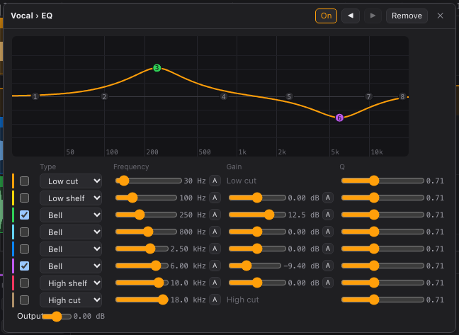

# Effects reference

FreeDAW's built-in effects. Add them from **+ Effect** on any [mixer](mixer.md) strip, including
buses and the master. Double-click any slider to reset it to its default.

## EQ

Shapes the tone with eight bands. Each band boosts or cuts around its frequency.

- **Drag a numbered point** on the curve to change that band's frequency (sideways) and gain (up
  and down). Dragging a band switches it on.
- The table below the curve has one row per band:

| Control       | Range          | What it does                                                                           |
| ------------- | -------------- | -------------------------------------------------------------------------------------- |
| (checkbox)    | on / off       | Switches the band on (**on**).                                                         |
| **Type**      | see below      | The band's shape (**type**).                                                           |
| **Frequency** | 20 Hz – 20 kHz | Where the band acts (**frequency**).                                                   |
| **Gain**      | −24 to +24 dB  | How much it boosts or cuts (**gain**). Low cut, high cut and notch bands have no gain. |
| **Q**         | 0.1 – 18       | Width: low values affect a wide range, high values a narrow one.                       |

Band types:

- **Low cut** removes everything below the frequency (rumble, handling noise).
- **Low shelf** boosts or cuts everything below the frequency.
- **Bell** boosts or cuts around the frequency.
- **High shelf** boosts or cuts everything above the frequency.
- **High cut** removes everything above the frequency.
- **Notch** removes a narrow band (a hum or a ringing resonance).

**Output** (−24 to +24 dB) sets the level after the EQ.

## Compressor

Evens out the level: when the signal gets louder than the threshold, it is turned down.

| Control       | Range        | Default | What it does                                                           |
| ------------- | ------------ | ------- | ---------------------------------------------------------------------- |
| **Threshold** | −60 – 0 dB   | −18 dB  | Level above which compression starts.                                  |
| **Ratio**     | 1:1 – 20:1   | 4:1     | How strongly: at 4:1, 4 dB over the threshold comes out as 1 dB over.  |
| **Attack**    | 0.1 – 100 ms | 10 ms   | How fast it reacts. Slower attacks let the start of each note through. |
| **Release**   | 10 – 1000 ms | 100 ms  | How fast it lets go after the signal drops.                            |
| **Knee**      | 0 – 24 dB    | 6 dB    | Softens the transition around the threshold.                           |
| **Makeup**    | 0 – 24 dB    | 0 dB    | Raises the level after compression.                                    |
| **Mix**       | 0 – 100%     | 100%    | Blend with the uncompressed signal ("parallel compression").           |

## Gate

Silences the signal when it falls below a threshold, to cut noise and bleed between notes.

| Control       | Range       | Default | What it does                                                 |
| ------------- | ----------- | ------- | ------------------------------------------------------------ |
| **Threshold** | −80 – 0 dB  | −50 dB  | Below this level, the gate closes.                           |
| **Range**     | 0 – 80 dB   | 80 dB   | How much it turns down when closed (80 dB is nearly silent). |
| **Attack**    | 0.1 – 50 ms | 1 ms    | How fast it opens.                                           |
| **Hold**      | 0 – 500 ms  | 20 ms   | How long it stays open after the signal drops.               |
| **Release**   | 5 – 1000 ms | 100 ms  | How fast it closes.                                          |

## Limiter

Stops the signal from going over a ceiling, usually as the last effect on the master.

| Control        | Range       | Default | What it does                                 |
| -------------- | ----------- | ------- | -------------------------------------------- |
| **Input gain** | 0 – 24 dB   | 0 dB    | Pushes the signal into the limiter (louder). |
| **Ceiling**    | −24 – 0 dB  | −1 dB   | The maximum output level.                    |
| **Release**    | 1 – 1000 ms | 50 ms   | How fast it recovers.                        |

## Delay

Echoes.

| Control       | Range           | Default | What it does                                                |
| ------------- | --------------- | ------- | ----------------------------------------------------------- |
| **Time**      | 1 – 2000 ms     | 375 ms  | Time between echoes (when **Sync** is off).                 |
| **Sync**      | see below       | Off     | Locks the time to the tempo instead.                        |
| **Feedback**  | 0 – 95%         | 35%     | How many echoes: higher values repeat longer.               |
| **Mix**       | 0 – 100%        | 25%     | Echo level. Use 100% on a bus fed by sends.                 |
| **Ping-pong** | on / off        | off     | Echoes alternate between left and right.                    |
| **Low cut**   | 20 – 2000 Hz    | 80 Hz   | Removes lows from the echoes.                               |
| **High cut**  | 500 Hz – 20 kHz | 8 kHz   | Removes highs from the echoes, for a darker, vintage sound. |

Sync values: **Off**, **1/4**, **1/8**, **1/8 dotted**, **1/8 triplet**, **1/16**, **1/2**.

## Reverb

Simulates a room or hall.

| Control       | Range          | Default | What it does                                             |
| ------------- | -------------- | ------- | -------------------------------------------------------- |
| **Pre-delay** | 0 – 200 ms     | 10 ms   | Gap before the reverb starts; keeps the dry sound clear. |
| **Size**      | 0 – 100%       | 50%     | Size of the simulated space.                             |
| **Decay**     | 0.2 – 20 s     | 2 s     | How long the reverb lasts.                               |
| **Damping**   | 1 kHz – 20 kHz | 6 kHz   | Highs above this fade faster, for a warmer sound.        |
| **Width**     | 0 – 100%       | 100%    | Stereo width: 0% is mono.                                |
| **Mix**       | 0 – 100%       | 25%     | Reverb level. Use 100% on a bus fed by sends.            |

## Chorus

Thickens a sound with slightly detuned copies.

| Control      | Range       | Default | What it does                                              |
| ------------ | ----------- | ------- | --------------------------------------------------------- |
| **Rate**     | 0.05 – 5 Hz | 0.8 Hz  | Speed of the movement.                                    |
| **Depth**    | 0 – 10 ms   | 3 ms    | Amount of movement.                                       |
| **Delay**    | 1 – 30 ms   | 7 ms    | Base delay of the copies.                                 |
| **Feedback** | 0 – 90%     | 0%      | Feeds the effect back for a metallic, flanger-like sound. |
| **Mix**      | 0 – 100%    | 50%     | Effect level.                                             |

## Saturation

Adds warmth and grit by driving the signal into distortion.

| Control    | Range            | Default | What it does                                                                        |
| ---------- | ---------------- | ------- | ----------------------------------------------------------------------------------- |
| **Drive**  | 0 – 36 dB        | 6 dB    | How hard the signal is pushed.                                                      |
| **Type**   | Soft, Hard, Tube | Soft    | Character: **Soft** is gentle, **Hard** is aggressive, **Tube** is warm and uneven. |
| **Tone**   | 1 kHz – 20 kHz   | 20 kHz  | Rolls off harsh highs.                                                              |
| **Output** | −24 – +12 dB     | 0 dB    | Level after saturation (drive makes things louder).                                 |
| **Mix**    | 0 – 100%         | 100%    | Blend with the clean signal.                                                        |

## Utility

Simple level and stereo tools.

| Control      | Range        | Default | What it does                                       |
| ------------ | ------------ | ------- | -------------------------------------------------- |
| **Gain**     | −60 – +24 dB | 0 dB    | Level change.                                      |
| **Balance**  | left – right | center  | Left/right balance.                                |
| **Invert L** | on / off     | off     | Inverts the polarity of the left channel.          |
| **Invert R** | on / off     | off     | Inverts the polarity of the right channel.         |
| **Mono**     | on / off     | off     | Sums the channels to mono (useful to check a mix). |
