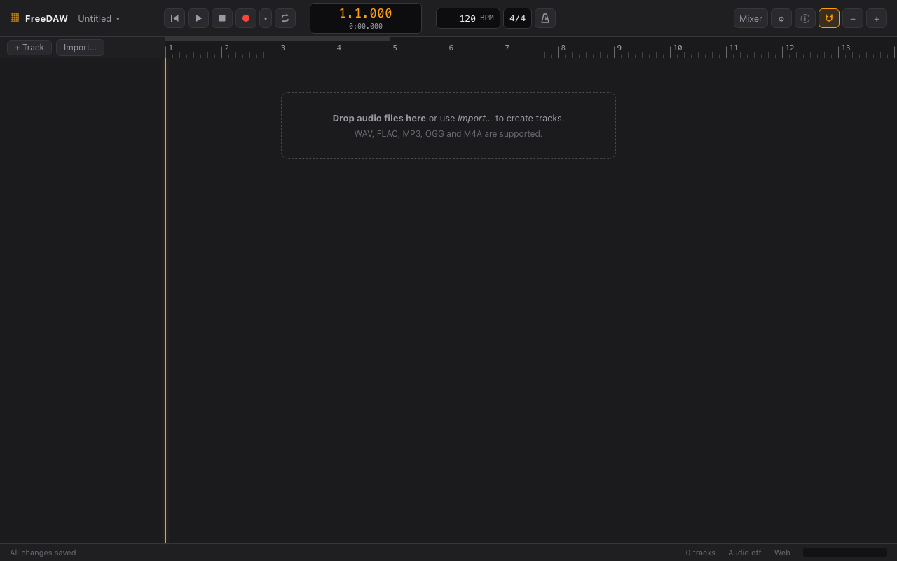
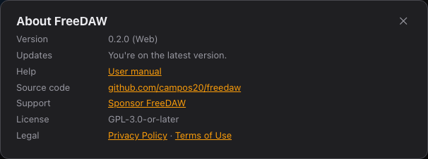

# Getting started

## Web or desktop?

FreeDAW comes in two editions with the same features and the same project format.

|                     | Web edition                                                      | Desktop edition                                                                 |
| ------------------- | ---------------------------------------------------------------- | ------------------------------------------------------------------------------- |
| Install             | Nothing: open [the web app](https://campos20.github.io/freedaw/) | Download from the [releases page](https://github.com/campos20/freedaw/releases) |
| Runs on             | Chromium-based browsers (Chrome, Edge, Brave…)                   | Windows, macOS, Linux                                                           |
| Audio interfaces    | Up to two input channels; the browser adds some latency          | All channels, low-latency drivers (ASIO, WASAPI, CoreAudio, ALSA/JACK)          |
| Where projects live | Inside the browser, on this computer                             | In the app's data folder                                                        |

Start with the web edition to try FreeDAW. Choose the desktop edition for serious recording with
a multichannel interface or when you need the lowest latency.

> The web edition currently targets Chromium-based browsers. Other browsers may not support every
> feature it needs.

## Your first project in five minutes

When FreeDAW opens for the first time, it creates an empty project called **Untitled**.

1. **Name it.** Click **Untitled** at the top left, type a name in the **Name** field and press
   Enter. See [Projects](projects.md).
2. **Bring in audio.** Drag audio files from your computer onto the timeline, or click
   **Import…**. Each file becomes a clip on its own track. WAV, FLAC, MP3, OGG and M4A files are
   supported.
3. **Play it.** Press the Space bar or click ▶. Press Space again to stop.
4. **Edit.** Drag clips to move them, drag their edges to trim them. See
   [Importing and editing audio](editing.md).
5. **Mix.** Click **Mixer** (or press X) to set levels and add effects. See [Mixer](mixer.md).
6. **Tune a vocal.** Double-click a vocal clip to open it in [Tune](tune.md).

There's no Save button: FreeDAW saves every change automatically. The status bar at the bottom
says **All changes saved** once your work is stored.

## Staying up to date

Click ⓘ in the toolbar to see your version and check for updates. The dialog also links to this
manual.

- **Web edition:** when a new version is out, reload the page.
- **Desktop edition:** click **Download** to get the new version from the releases page.

## Next steps

- Take the [tour of the interface](interface.md).
- Set up your microphone or audio interface and [record](recording.md).
