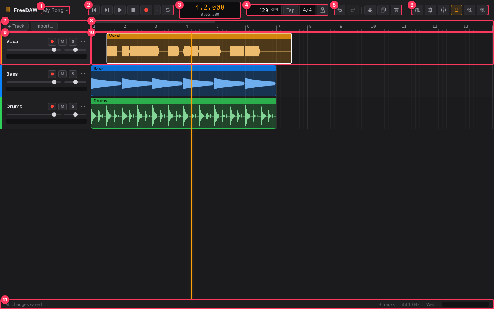

# The interface

1. **Project menu.** The current project's name. Click it to rename the project, create a new one,
   open a recent one, or import and export project files. See [Projects](projects.md).
2. **Transport controls**, from left to right:
   - ⏮ **Return to start** (Home or Enter)
   - ⏭ **Go to end** of the last clip (End)
   - ▶ **Play / pause** (Space)
   - ■ **Stop**
   - ● **Record** the armed tracks (R), and ▾ **Recording options** next to it. See
     [Recording](recording.md).
   - 🔁 **Loop** (L): repeat the loop region while playing.
3. **Position display.** The playhead position in bars, beats and ticks (top) and in minutes and
   seconds (bottom).
4. **Tempo and metronome.** Type a tempo in BPM (20 to 300) and press Enter, or click **Tap** (or
   press T) a few times along with the beat to set it by ear. The tempo follows your last few taps;
   a two-second pause ends the run, and you can undo the whole run in one step. Next to it is the
   time signature and the **Metronome** button (C), which plays a click while you play or record.
5. **Edit tools**, from left to right. They act on the selection; a tool is greyed out when there's
   nothing for it to act on. See [Importing and editing audio](editing.md).
   - ↶ **Undo** (⌘/Ctrl + Z) and ↷ **Redo** (⇧ Shift + ⌘/Ctrl + Z)
   - ✂ **Split** (S): cuts the selected clips, or every clip on the selected track, at
     the playhead.
   - ⧉ **Duplicate** the selected clips (⌘/Ctrl + D)
   - 🗑 **Delete** the selected clips, or the selected track when no clip is selected (Delete)
6. **View and settings**, from left to right:
   - 🎚 **Mixer** (X): opens the mixer at the bottom. See [Mixer](mixer.md).
   - ⚙ **Settings**: language and audio devices. See [Settings](settings.md).
   - ⓘ **About FreeDAW**: version, updates and links.
   - 🧲 **Snap to grid** (N): edits snap to the visible grid lines.
   - 🔍 **Zoom out** and **zoom in** (− and +).
7. **+ Track** adds an empty track below the selected one. **Import…** adds audio files.
8. **Ruler.** Bar numbers. Click anywhere on it to move the playhead there. The bar along its top
   edge shows the loop region (blue when looping is on).
9. **Track header.** The track's name and controls: arm for recording (●), mute (**M**), solo
   (**S**), the ⋯ menu, volume and pan sliders, and a level meter. See
   [Importing and editing audio](editing.md#tracks).
10. **Lane.** The track's clips along the timeline. The orange vertical line is the playhead.
11. **Status bar.** Save status, progress of long tasks, errors (click one to dismiss it), audio
    dropouts, the number of tracks, the audio sample rate, the edition (Web or Desktop) and the
    master level meter.

## The bottom pane

The bottom of the window shows either the **Mixer** or the **Tune** editor. Opening one closes
the other. Drag the top edge of the pane to make it taller or shorter.

## Moving around

- **Scroll the timeline:** Shift + mouse wheel, or swipe sideways on a trackpad.
- **Zoom:** ⌘/Ctrl + mouse wheel, pinch on a trackpad, or the + and − keys. Zooming with the keys
  keeps the playhead in place.
- While playing, the view follows the playhead.
