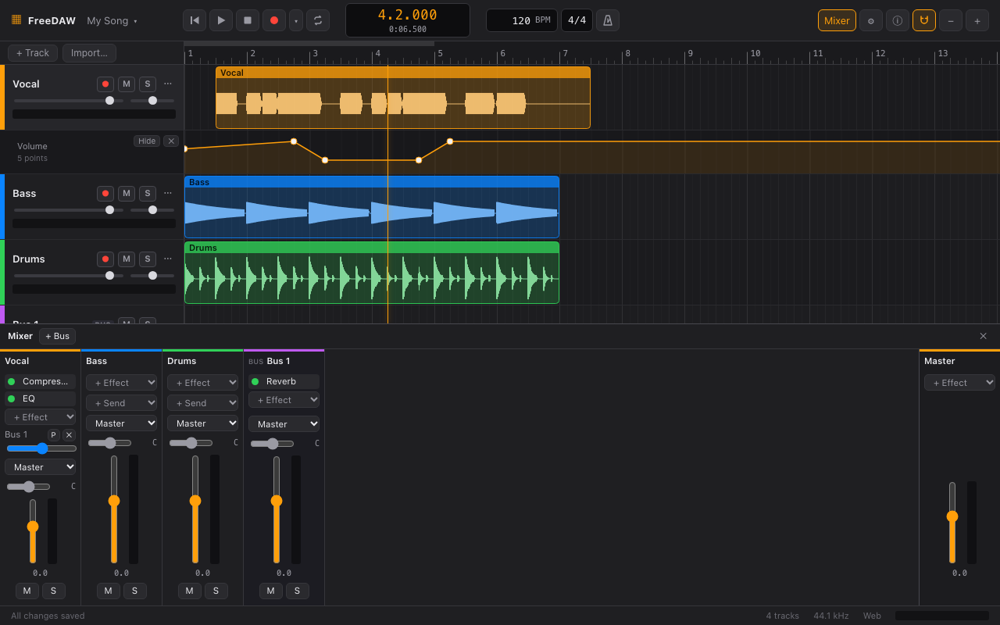
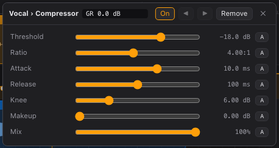

# Mixer

Click **Mixer** in the toolbar (or press X) to open the mixer at the bottom of the window. It has a
channel strip for each track, and the **Master** strip on the right.

## A channel strip, from top to bottom

- **Name** of the track. Buses are marked **BUS**.
- **Effects** (inserts): the track's effect chain, processed from top to bottom. **+ Effect** adds
  one. See [Effects](#effects).
- **Sends:** copies of the track's signal going to buses (see below). **+ Send** adds one.
- **Output:** where the track goes, **Master** or a bus.
- **Pan** slider: left/right position. **C** is center; **50L** means halfway left. Double-click to
  center.
- **Fader** and meter: the track's volume. Double-click the fader to reset it to 0 dB. The meter
  turns red when the signal clips.
- **M** mute, **S** solo.

The **Master** strip has its own effects and fader, which affect the whole mix.

## Buses and sends

A **bus** is a track without clips that mixes signals sent to it. Use buses to share one effect
between several tracks (a common reverb, for example) or to control a group of tracks with one
fader.

1. Click **+ Bus** in the mixer header. A new bus track appears.
2. On a track, choose the bus under **+ Send**. A send level slider appears.
3. Add an effect to the bus, for example a reverb with **Mix** at 100%.
4. Raise the send to add more of the effect to that track.

Sends are **post-fader** by default: turning the track's fader down also turns down what it sends.
Click **P** to make a send **pre-fader**, independent of the fader. ✕ removes the send.

To route a track entirely through a bus (for example, to group drums), choose the bus as the
track's **Output**. Routings that would create a loop are greyed out.

## Effects

- **Add:** choose from **+ Effect** on a strip. The effect's editor opens.
- **Edit:** click the effect's name in the strip.
- **Bypass:** click the green dot next to its name to switch the effect off without removing it.
- **Reorder or remove:** use ◀ ▶ and **Remove** in the effect's editor.

In an effect's editor:

- Drag a slider to change a setting. Double-click it to go back to the default.
- **On / Bypassed** switches the effect off and on.
- **A** creates an [automation](automation.md) lane for that setting.
- Compressor, gate and limiter show **GR**: how much they are turning the signal down right now.

The [effects reference](effects.md) describes every effect and its controls.
