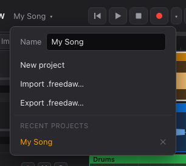

# Projects

A project holds your tracks, clips, mix, automation and Tune edits, plus the audio files they use.

## Saving

FreeDAW saves automatically, a moment after each change. The status bar shows:

| Status                | Meaning                                                                                             |
| --------------------- | --------------------------------------------------------------------------------------------------- |
| **All changes saved** | Everything is stored.                                                                               |
| **Unsaved changes**   | A save is about to happen.                                                                          |
| **Saving…**           | Writing now.                                                                                        |
| **Save failed**       | Something went wrong; an error message explains what. Your work is still open, so try exporting it. |

Changes are also saved when you switch projects or close the browser tab.

## The project menu

Click the project name at the top left.

- **Name**: type a new name and press Enter.
- **New project**: starts an empty project. The current one stays in the list.
- **Import .freedaw…**: opens a project file (see below) as a new project.
- **Export .freedaw…**: saves the current project, with its audio, as a single file.
- **Recent projects**: click one to open it. Hover over a name to see when it was last saved.
  The ✕ next to a project deletes it and its audio, after asking you to confirm. This can't be
  undone.

## Where projects are stored

- **Web edition:** inside the browser, on this computer, for this website only. Clearing the
  browser's site data for FreeDAW deletes your projects, and they don't follow you to another
  browser or computer.
- **Desktop edition:** in the app's data folder on your computer.

## Backing up and sharing

Use **Export .freedaw…** to save a project file you can back up, send to someone or move between
the web and desktop editions. A `.freedaw` file contains the project and all of its audio, so it
can be large. **Import .freedaw…** opens it as a new project; it never replaces an existing one.

> Export your important projects regularly, especially in the web edition.

Project files from before FreeDAW was renamed (`.tessera`) can still be imported.
