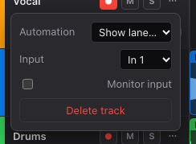
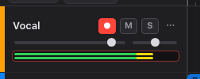
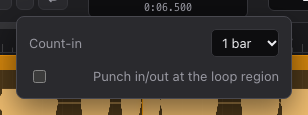

# Recording

## Before you start

1. Connect your microphone or audio interface.
2. Open ⚙ **Settings** and pick your devices under **Devices**, then click **Apply**. See
   [Settings](settings.md).
3. Calibrate the latency once per setup (see [below](#latency-calibration)), so recordings line up
   with what you hear.

> **Use headphones** while recording with the metronome or other tracks playing, so the
> microphone doesn't pick them up.

In the web edition, the browser asks for permission to use the microphone the first time you arm a
track. Allow it, or recording won't work.

## Choosing the input

Each track records from one input channel (mono) or a pair (stereo). Open the track's ⋯ menu and
choose it under **Input**: **In 1**, **In 2**… for mono, **In 1+2** for stereo.

**Monitor input** sends what the input hears to your speakers or headphones, even when stopped,
so you can hear yourself through FreeDAW's effects. If your interface has its own direct
monitoring, leave this off to avoid hearing yourself twice.

## Recording a take

1. **Arm** the track: click its ● button. It turns red and the meter shows the input level. Sing
   or play and check that the meter stays out of the red.

   

2. Move the playhead to where you want to start.
3. Press **R** or click ● **Record** in the transport. After the count-in, recording starts.
4. Press **Space**, **R** or ■ **Stop** to finish.

The recording becomes a new clip on the armed track, named after the track (for example
"Vocal take 1"). You can arm several tracks to record them at once, each from its own input.
Arming and monitoring aren't saved with the project; re-arm tracks after reopening it.

## Count-in and punch

Click ▾ next to the Record button.

- **Count-in:** plays the metronome for **1 bar** or **2 bars** before recording starts, or
  **Off**.
- **Punch in/out at the loop region:** records only inside the loop region, so you can redo a
  section without touching the rest. Start playback before the region; recording starts and stops
  by itself.

> The loop region can't be changed from the interface yet: new projects loop over the first
> 8 seconds (bars 1 to 5 at 120 BPM).

With **Loop** on, each pass through the loop becomes a separate take.

## Latency calibration

Sound takes a little time to travel through your computer and interface. FreeDAW shifts
recordings back by this round-trip delay so they line up with the other tracks and the click.
Until you calibrate, it uses an estimate. Calibration measures the real delay:

1. Connect a cable from an **output** of your interface to an **input**.
2. Turn your speakers down (the test plays loud clicks).
3. Open ⚙ **Settings**. Under **Latency compensation**, choose the input the cable is plugged into
   (**Loopback input**) and click **Calibrate**.
4. FreeDAW plays the metronome for a few seconds, records it back and shows the measured delay.

The value is remembered for this combination of devices, sample rate and buffer size. Calibrate
again when you change any of them. If no clicks are detected, check the cable and the input
channel, and turn the output up a little.

## Problems while recording

- **"Recording fell behind and audio was lost"**: the computer couldn't keep up. The take has a
  gap and its name says "(audio lost)". Try a larger buffer size in [Settings](settings.md), or
  record fewer tracks at once.
- See [Troubleshooting](troubleshooting.md) for more.
