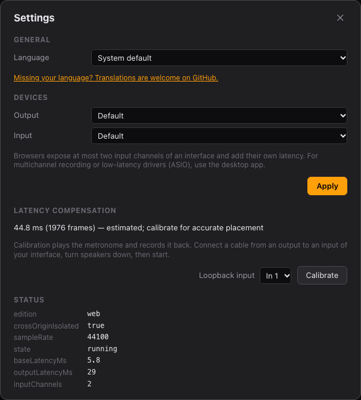

# Settings

Click ⚙ in the toolbar.

## General

**Language** sets the interface language. **System default** follows your browser or computer's
language when FreeDAW supports it, and English otherwise. The change applies immediately.

FreeDAW is available in English and Brazilian Portuguese. To add your language, see
[Translating FreeDAW](../../../packages/ui/src/i18n/README.md).

## Devices

Choose the devices, then click **Apply**.

| Setting         | What it does                                                                                                                                                              |
| --------------- | ------------------------------------------------------------------------------------------------------------------------------------------------------------------------- |
| **Driver**      | Desktop only: the audio system (for example ASIO or WASAPI on Windows, CoreAudio on macOS, ALSA or JACK on Linux).                                                        |
| **Output**      | Where you hear FreeDAW.                                                                                                                                                   |
| **Input**       | The microphone or interface to record from. **None** turns recording off.                                                                                                 |
| **Sample rate** | Desktop only: audio quality in samples per second. 44.1 or 48 kHz is fine for most work.                                                                                  |
| **Buffer size** | Desktop only: how much audio is processed at a time. Smaller is more responsive (less latency) but needs more from the computer; raise it if you hear clicks or dropouts. |

In the web edition, the browser decides the sample rate and buffer size, and it can use at most two
input channels of an interface. For multichannel recording or low-latency drivers, use the desktop
edition.

Settings are remembered. The desktop edition reopens your devices when it starts; the web edition
opens the input when you first arm a track.

## Latency compensation

Shows the delay FreeDAW corrects recordings by, and whether it was **calibrated** or is an
**estimate**. See [Latency calibration](recording.md#latency-calibration).

## Status

Technical details about the audio engine, useful when reporting a problem. **dropouts** counts
interruptions in the audio since the device was opened.
