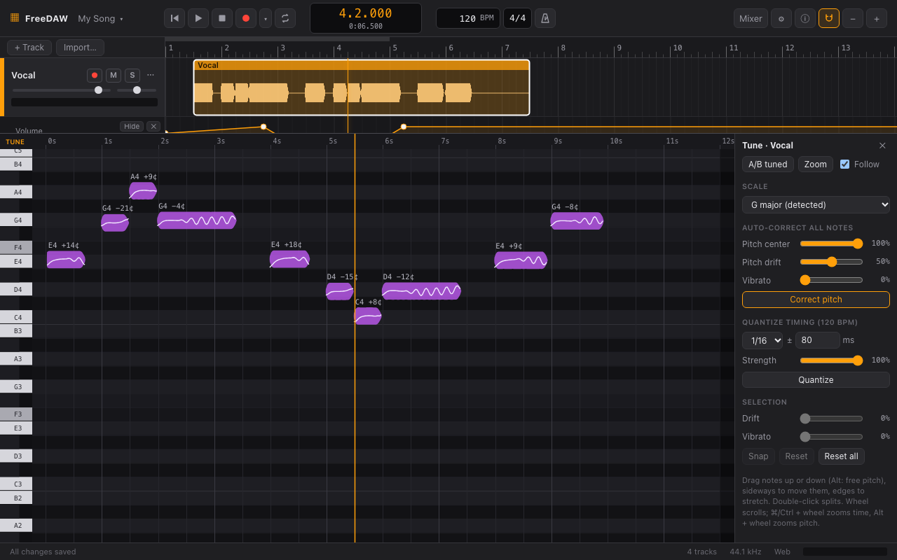
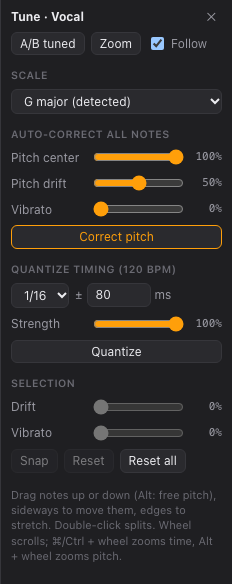
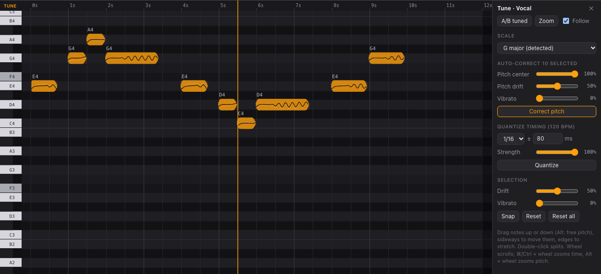

# Tune

Tune lets you correct pitch and timing **note by note**. It works on recordings of a single voice
or instrument playing one note at a time: vocals, bass, solo instruments. It isn't meant for
chords or full mixes.

Your edits are saved with the project, and the original recording is never changed: you can
reset any note at any time.

## Opening a clip

Double-click a clip. FreeDAW analyzes it (the status bar shows **Analyzing pitch…**) and opens it
in the Tune editor at the bottom of the window, with the notes it found, the detected key and the
song's tempo.

- Each **note** is a block placed at its pitch (the keyboard on the left shows which note) and
  time. The line inside it is the pitch you actually sang, including slides and vibrato.
- The label above a note shows the nearest note name and how far off it is in **cents**
  (hundredths of a semitone): **G4 −21¢** is 21 cents flat of G4.
- The ruler at the top shows seconds from the start of the clip. Faint vertical lines mark beats.
- The badge at the top left says **TUNE** when you hear the tuned result and **ORIG** when you
  hear the original.

## Editing notes

| To                     | Do                                                                                |
| ---------------------- | --------------------------------------------------------------------------------- |
| Select a note          | Click it. Shift-click adds to the selection; drag on an empty area to box-select. |
| Select all / none      | ⌘/Ctrl + A / Escape (with the pointer over the editor)                            |
| Change pitch           | Drag a note up or down. It snaps to semitones; hold Alt for free pitch.           |
| Move by a semitone     | ↑ / ↓. With Shift: an octave.                                                     |
| Move in time           | Drag a note sideways.                                                             |
| Make longer or shorter | Drag a note's left or right edge.                                                 |
| Split a note in two    | Double-click where you want to cut.                                               |

**Navigating:** the mouse wheel scrolls, ⌘/Ctrl + wheel zooms in time, Alt + wheel zooms in pitch.
Click the ruler to move the playhead. **Zoom** fits the selection (or all notes) in view, and
**Follow** keeps the playhead in view during playback.

## The side panel

- **A/B tuned / A/B original:** switch between hearing your edits and the original recording.
- **Scale:** the key used by auto-correct. The detected key is marked **(detected)**. Choose
  **Chromatic** to allow every semitone.

### Auto-correct

Corrects the selected notes, or all notes when none is selected, when you click **Correct pitch**:

- **Pitch center:** how far each note moves toward the nearest note of the scale. 100% lands
  exactly on it; 50% goes halfway, for a more natural result.
- **Pitch drift:** how much of the slow wandering within each note is flattened.
- **Vibrato:** how much of the vibrato is removed. Keep it low to preserve expression.

### Quantize timing

Moves note starts toward a rhythmic grid at the project tempo, then click **Quantize**:

- **Grid:** 1/4, 1/8, 1/16 or 1/32 notes.
- **± ms (tolerance):** only notes within this distance of a grid line move, so notes played off
  the grid on purpose stay put.
- **Strength:** how far notes move toward the grid. 100% lands exactly on it.

### Selection

Adjusts the selected notes directly:

- **Drift** and **Vibrato:** the same as in auto-correct, for the selected notes only.
- **Snap:** moves the selected notes to the nearest semitone.
- **Reset:** restores the selected notes to how they were sung.
- **Reset all:** restores every note in the clip.

## Tips

- Start with auto-correct at moderate settings, then fix individual notes by hand.
- Use A/B often: small corrections usually sound best.
- If a note is detected wrongly (for example, two notes as one), split it first.
- All Tune edits are part of the normal undo history (⌘/Ctrl + Z).
- Click ✕ in the panel to close the editor. Edited clips keep playing tuned.
